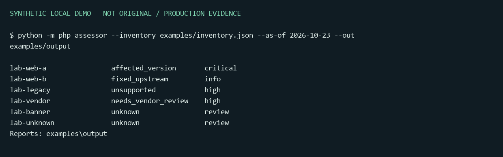

# PHP2Shell Security Assessor

**Portfolio area:** [Cybersecurity](https://github.com/alefkaue#cybersecurity) · **Context:** Personal project

Offline, evidence-aware triage for **CVE-2026-109618** and **CVE-2026-109619**.
Built by Alef Kaue Santos Nunes as a personal learning project with AI-assisted development.
It inventories supplied evidence; it does not exploit servers or certify that a host is safe.

[Português](README.pt-BR.md) · [Decision model](docs/assessment-model.md) · [Research](docs/research.md)



## Run in one minute

Python 3.11+; **zero third-party runtime dependencies**. From this directory:

```console
python -m php_assessor --inventory examples/inventory.json --as-of 2026-10-23 --out examples/output
python -m unittest discover -s tests -v
```

The example is synthetic. Expected classifications include affected upstream version,
fixed upstream version, unsupported branch, package needing vendor review and unknown evidence.
Open `examples/output/assessment.html` locally, or consume the JSON/Markdown reports.

Optional installation in a virtual environment:

```console
python -m venv .venv
# Activate .venv using your operating system's activation command.
python -m pip install .
php2shell-assessor --help
```

## Why this is more than a version comparison

| Evidence or condition | Classification | Meaning |
|---|---|---|
| Stock version below its branch fix | `affected_version` | Published version range matches; exploitability/compromise NOT established |
| Stock version at/above its branch fix | `fixed_upstream` | These two CVEs are fixed according to supplied version; not an overall security verdict |
| Old distributor package with unknown backport | `needs_vendor_review` | Check the exact vendor build rather than producing a false vulnerability claim |
| Verified operator-supplied reference covering both CVEs | `vendor_fix_recorded` | Attestation recorded; reference not independently authenticated by this offline tool |
| Upstream lifecycle ended | `unsupported` | Independent lifecycle concern, even with an incident-specific fix |
| Missing, malformed, prerelease, new branch, tag/header only | `unknown` | Gather authoritative runtime and patch evidence |

Each asset also records `cve_assessment`, lifecycle state, evidence kind, source evidence,
exposure, reasons, configuration observations and recommendations. Internet exposure
raises remediation priority; it does not prove that an exploit works.
The report retains the published CVSS v4 score separately; per-asset `severity` is local remediation priority, not a recalculated CVSS score.

## Inputs and examples

```console
python -m php_assessor --inventory examples/inventory.csv --out reports
python -m php_assessor --local --php-binary php --php-ini /owned/config/php.ini
python -m php_assessor --docker-inspect examples/docker-inspect.json
python -m php_assessor --sbom examples/cyclonedx.json
python -m php_assessor --inventory examples/inventory.json --fail-on-risk
```

- JSON: array of assets with unique `id`, `version`, `exposure` (`internet`, `internal`, `offline`, `unknown`).
- `evidence_kind`: `inventory` (operator-supplied default), `local_cli`, `sbom`, `http_header`, `docker_tag`, `unknown`.
- Optional `sapi`, `evidence`, `vendor_package` boolean and scalar `config` object.
- For recorded vendor fixes, use the structure in `examples/vendor-backport.json`. The operator must validate the reference first.
- CSV supports flat columns; nested configuration and vendor evidence require JSON.
- Docker support consumes an **existing inspect export**, never contacts the daemon, starts containers or trusts mutable tags as runtime measurements.
- CycloneDX support reads exact `php`/`php-src` components. It does not assess arbitrary PHP libraries or establish deployment state.

`--local` invokes only the selected local binary with `-n -v`, using a subprocess argument
list and timeout. It does not establish the version of FPM/mod_php or read application secrets.
`--php-ini` reads only an explicitly provided file, exporting a small allowlist of directives.
Configuration overlays and worker restarts must be checked separately.

## Reports and exit codes

`--format all|json|md|html`; `--out DIRECTORY`; `--as-of YYYY-MM-DD`.
The assessment date cannot precede the reviewed advisory snapshot. After 30 days the report
warns that the snapshot needs review. Report generation does not update advisory data automatically.

| Exit | Meaning |
|---|---|
| 0 | Report produced; read its findings, including unknowns |
| 1 | `--fail-on-risk` enabled and at least one high/critical finding |
| 2 | Invalid input, missing executable, timeout or I/O failure |

HTML escapes operator-controlled data, contains no scripts and makes no external requests.
Reports include input SHA-256 and the advisory review date. Store real inventories/reports privately;
only synthetic examples belong in public commits.

## Scope and engineering choices

The CLI separates parsers, decision rules, local collection and reporting. A versioned JSON
snapshot makes the decision reproducible. Tests cover all four fixed-version boundaries,
backports, EOL dates, unknowns, config handling, report escaping, invalid inputs and CLI output.
CI runs on Linux and Windows with Python 3.11 and 3.13.

Docker-export and CycloneDX import add useful inventory context. A web dashboard was deliberately
omitted: static HTML already serves the review use case without adding a service or authentication burden.
This project is not affiliated with PHP, CERT-EU or NCSC, and did not discover these CVEs.

## Official sources

- [PHP security releases and advisory](https://www.php.net/archive/2026.php)
- [OOM advisory](https://github.com/php/php-src/security/advisories/GHSA-w8hw-w9fx-j79w)
- [Stale-state advisory](https://github.com/php/php-src/security/advisories/GHSA-6wmf-4rv5-p3rp)
- [Supported branches](https://www.php.net/supported-versions.php)
- [CERT-EU 2026-018](https://www.cert.europa.eu/publications/security-advisories/2026-018)
- [NCSC alert](https://www.ncsc.gov.uk/news/critical-security-issue-affecting-php)

MIT license applies to original code and documentation. Linked advisories remain their authors' work.
