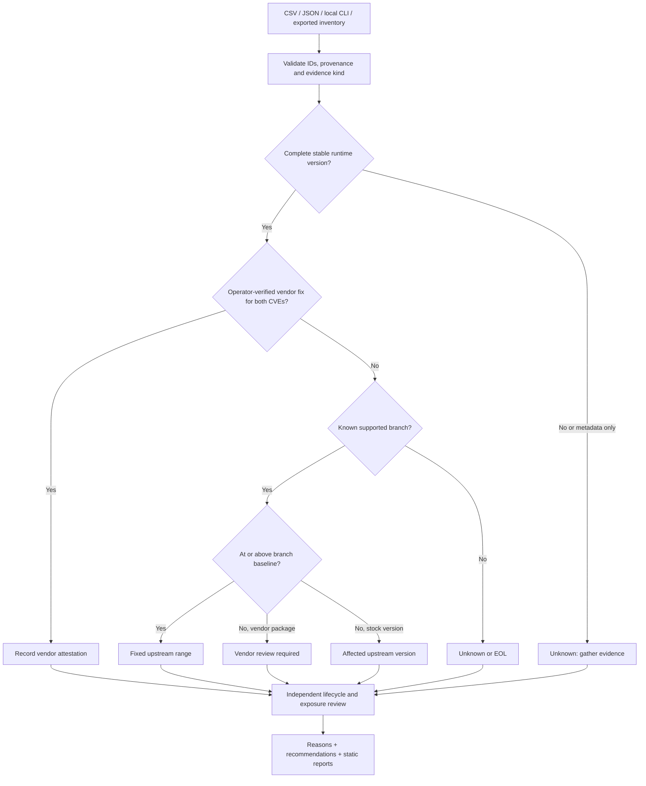

# Decision and trust model

## Trust boundaries

Input inventory is an operator statement, not remote attestation. A forged inventory can produce
incorrect conclusions. The tool records that origin and its input hash; hashes prove file identity,
not authenticity. Headers and Docker tags never become version-confirmation evidence.

The offline vendor-fix field is explicitly an operator attestation, not a fetched/signed advisory.
Both CVE IDs and a reviewed HTTPS reference are required. `unsupported` can override the display
status while `cve_assessment` retains the incident-specific interpretation.

HTML escapes untrusted fields. The CLI escapes control characters in asset names. Configuration
exports only an allowlist and does not evaluate PHP expressions. Inputs are size-limited; duplicate
IDs and empty inventories fail rather than generating a misleading empty clean report.

## Reproduce and explain in an interview

1. Run the synthetic inventory and inspect `lab-vendor` versus `lab-web-a`.
2. Explain why a package version below the upstream threshold can still contain a backport.
3. Show that an old header alone remains unknown.
4. Inspect a fixed version's reasons: it does not claim the application is secure.
5. Run the HTML-escaping and branch-boundary tests.

No PHP web application is started. There is no exploit trigger, live scanner, Docker socket mount,
automatic upgrade, external telemetry or hosted UI. Production inventories remain local.
